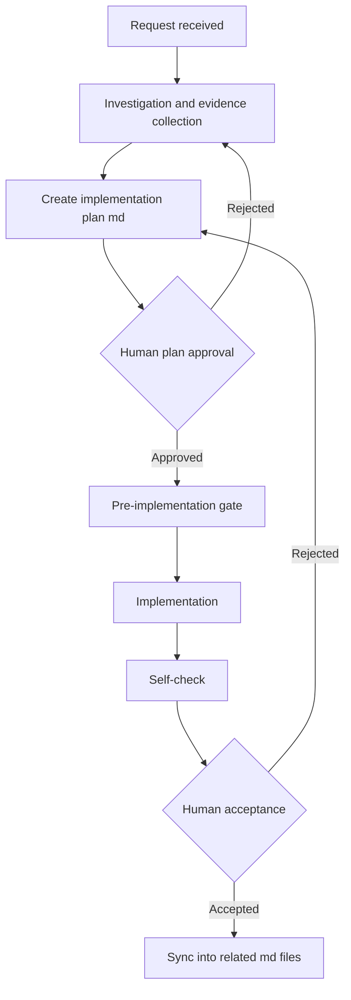

# Workflow gates (separation of planning and execution)

## 0. The three absolute rules

1. **Humans own the responsibility.** AI can propose but cannot decide. The final release/adoption judgment is always made by a human. "Because the AI said so" is never an excuse. AI vendors disclaim all responsibility in their terms of service; the responsibility for deliverables lies entirely with the user.
2. **Plan on evidence.** To prevent "plausible completion" (hallucination), build investigation and evidence collection into the task before implementation. Evidence = the relevant parts of specs, existing code, API docs, logs, etc. Treat past blog posts and forum content as weak evidence. Do not move to the next phase until the evidence is complete.
3. **Separate planning from execution.** The planning phase and the implementation phase are completely separated. A human always reviews and approves the plan, and only the approved plan proceeds to implementation.

## 1. Phase flow

- Keep the deliverables of each phase (evidence, plan) as md, and hand them over explicitly when crossing phases.
- The plan md must contain: the list of files to modify/add, the change details (what, why, how), test case proposals, and impact scope with risks.
- For the order of failure predictions and desired tests, `rules/03-test-before-implementation.md` and `skills/backend-test-first/SKILL.md` are authoritative.

## 2. doc-first

- Whenever you investigate or confirm something, always start from existing md (the authoritative documentation directory from SETUP-CHECKLIST A3). Do not read source code first to investigate. This applies to execution commands, procedures, configuration values, and specification checks — everything.
- If an existing md covers it, that is authoritative, and answers must state the referenced md name.
- Only when the md is missing or stale, check the source, and if necessary create or update the md.
- For non-trivial work (implementation, test generation, performance improvement), write the procedure into a plan md (the SETUP-CHECKLIST A4 directory; create one if missing) before starting, and follow it. Do not start on the fly. If the procedure changes mid-work, fix the md first, then continue.

## 3. Approval before edits

- Request → investigation → edit plan → human approval → execution. Template: `skills/edit-plan-approval/SKILL.md`.
- **A request is not an approval.** A user's request, question, or policy consultation is not approval for file edits. Never execute on request phrases alone ("go ahead", "implement it", "create it").
- Approval = an explicit reply such as OK / approved / execute it, after reading the edit plan.
- If even one file creation/change/deletion turns out to be necessary, present the edit plan before executing (1 request = 1 plan; no per-file approvals).
- Execute only within the approved plan. Out-of-scope changes, new files, or direction changes require a new edit plan and re-approval. No "while we're at it" fixes.
- commit / push follow SETUP-CHECKLIST B5 (default: always manual by the human; a request or plan approval is not a commit permission).

## 4. Post-acceptance md sync (endpoint processing)

- When the human acceptance/testing completes, sync the work content into the related md files. **Code updates and documentation updates always come as a set.**
- Run the endpoint processing of the work log (derived from `templates/work-log-skeleton.md`): leave the confirmed procedures and results in the plan md, and archive the temporary trial-and-error logs.
- A stale-document state is the biggest trigger of AI hallucination. Never leave it behind.
- For work that needs a tester checklist md (human test items), confirm it exists before acceptance.

## 5. Mode selection and risk

Remap this table to the real mode names of your tool (SETUP-CHECKLIST B1).

| Mode type | Capabilities | Code changes | Risk |
|---|---|---|---|
| Investigation (Ask-like) | Read-only questions, investigation, interpretation | None | Almost zero |
| Planning (Plan-like) | Creating design docs and plan md | None (handed to the execution mode after approval) | An incomplete plan leads to destructive implementation. Human review is mandatory |
| Debugging (Debug-like) | Evidence-first investigation → fix, in one flow | Yes (investigative instrumentation → real fix once the cause is confirmed) | If the fix grows large, decide to switch to the planning mode |
| Execution (Agent-like) | Implementing approved plans, running commands, fixing errors | Yes (autonomous decisions and execution) | Highest. Limited to skilled/rule-clear simple tasks and approved plans |

- The execution mode is not "almighty": **plans first, or simple tasks only.** Handing complex requirements over without a plan causes destruction dragging in unrelated files, hallucination loops, and infinite token consumption. Critical logic always goes through plan approval.

## 6. Cost and autonomy

- Reserve expensive models for the critical judgments (planning, complex analysis) and run the execution phase on low-cost models (where model selection is available).
- The higher the autonomy, the more waste from hallucination. **Design the autonomy within the range where productivity improves even after tolerating the waste.** Decision criteria: critical logic → investigation → planning → execution / simple routine work → skill-ized execution loops / token cost first → planning, then a human implements / incident investigation → debug mode end to end.
- The pre-response self-check (`rules/02-response-self-check.md`) raises the first-pass approval rate and improves total cost (time + tokens). "The more you rush, the more you enforce the self-check."

