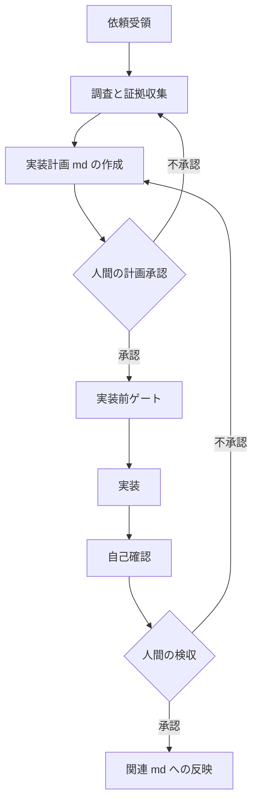

# ワークフローゲート（計画と実行の分離）

## 0. 3つの絶対ルール

1. **責任は人間が持つ。** AI は提案はできるが決定はできない。最終リリース・採用の判断は必ず人間が行う。「AI がこう言ったから」は言い訳にならない。AI 提供企業は利用規約で責任を免責しており、成果物に対する責任はすべて利用者側にある。
2. **証拠ベースで計画させる。** 「それっぽい補完（錯覚）」を防ぐため、実装前に調査と証拠収集をタスクに組み込む。証拠 = 仕様書該当箇所・既存コード該当箇所・API ドキュメント・ログ等。過去の実装記事やフォーラムの内容は薄い証拠として扱う。証拠が揃うまで次のフェーズに進ませない。
3. **計画と実行を分離する。** 計画フェーズと実装フェーズは完全に分離する。計画は必ず人間がレビュー・承認し、承認された計画だけが実装に進む。

## 1. フェーズフロー

- 各フェーズの成果物（証拠・計画）は md として残し、フェーズをまたぐときは明示的に引き継ぐ。
- 計画 md には、修正・追加するファイル一覧、変更内容（何を・なぜ・どうやって）、テストケース案、影響範囲とリスクを書く。
- 失敗予測と desired テストの順序は `rules/03-test-before-implementation.md` と `skills/backend-test-first/SKILL.md` を正とする。

## 2. doc-first

- 何かを調べる・確認するときは、常にまず既存 md（SETUP-CHECKLIST A3 のドキュメント正本ディレクトリ）を探す。ソースコードを最初に読んで調べない。実装調査だけでなく、実行コマンド・手順・設定値・仕様の確認すべてに適用する。
- md に該当記述があればそれを正とし、回答には参照した md 名を明記する。
- md が無い・古いと判明したときのみソースを確認し、必要なら md を作成・更新する。
- 非自明な作業（実装・テスト生成・性能改善等）は、着手前に手順を plan md（SETUP-CHECKLIST A4 のディレクトリ。無ければ新規作成）にまとめ、それに従って実行する。行き当たりばったりで着手しない。作業中に手順が変わったら md を先に直してから続行する。

## 3. 編集前承認

- 依頼 → 調査 → 編集計画 → 人間の承認 → 実行。テンプレートは `skills/edit-plan-approval/SKILL.md`。
- **依頼は承認ではない。** ユーザーの依頼・質問・方針相談は、ファイル編集の承認にならない。「進めて」「実装して」「作成して」等の依頼語だけでは実行しない。
- 承認 = 編集計画を読んだうえでの OK・承認・実行して等の明示的返答。
- ファイルの作成・変更・削除が 1 件でも必要と判断したら、実行前に編集計画を提示する（1 依頼 = 1 計画。ファイル 1 件ずつの承認は不要）。
- 承認された計画の範囲だけ実行する。範囲外・新規ファイル・方針変更は、新しい編集計画を出して再承認を取る。計画にない「ついで」修正をしない。
- commit / push の運用は SETUP-CHECKLIST B5 に従う（既定は常に人間手動。依頼・計画承認は commit 許可にならない）。

## 4. 検収後の md 反映（終点処理）

- 人間の検収・テストが完了したら、作業内容を関連 md へ反映させる。**コード更新とドキュメント更新は必ずセット。**
- 作業ログ（`templates/work-log-skeleton.md` 由来）の終点処理を実行する: 確定した手順と結果を plan md へ残し、一時的な試行錯誤のログは退避する。
- 「ドキュメントが古い」状態は AI の錯覚を誘発する最大の要因である。放置しない。
- テスター用 md（人間のテスト項目）が必要な作業では、検収前に作成済みであることを確認する。

## 5. モード選択とリスク

利用ツールのモード体系の実名へ読み替えて使う（SETUP-CHECKLIST B1）。

| モード種別 | できること | コード変更 | リスク |
|---|---|---|---|
| 調査（Ask 相当） | 読み取り専用で質問・調査・解釈 | なし | ほぼゼロ |
| 計画（Plan 相当） | 設計書・計画書 md の作成 | なし（承認後に実行モードへ引き継ぐ） | 計画が不完全だと破壊的実装に繋がる。人間のレビューが絶対条件 |
| デバッグ（Debug 相当） | 証拠ファーストで調査 → 修正まで一貫 | あり（調査用の計装 → 原因確定後の本修正） | 修正が大規模になる場合は計画モードへ切り替える判断が必要 |
| 実行（Agent 相当） | 承認済み計画の実装・コマンド実行・エラー修正 | あり（自律的に判断して実行） | 最大。スキル化済み・ルール明確な単純タスクと承認済み計画に限定 |

- 実行モードは「万能」ではない。**計画ありき・または単純タスク限定。** 計画なしに複雑な要件を渡すと、無関係ファイルを巻き込んだ破壊と錯覚ループ・トークンの無限消費が起きる。クリティカルなロジックは必ず計画承認を経る。

## 6. コストと自律度

- 高額モデルは計画策定・複雑な解析など「ここぞ」の判断に温存し、実行フェーズは低コストモデルで回す（モデル選択が可能な環境の場合）。
- 自律度を上げるほど錯覚による無駄なトークン消費が増える。**無駄を許容しても生産性が向上する範囲で自律度を設計する。** 判断基準: 重要なロジック → 調査→計画→実行／単純な定型作業 → スキル化された実行ループ／トークンコスト最優先 → 計画後に人間が実装／障害調査 → デバッグモードで一貫。
- レスポンス前の自己確認（`rules/02-response-self-check.md`）は一発承認率を上げてトータルコスト（時間＋トークン）を改善する。「急ぐほど、自己確認を徹底する」。

